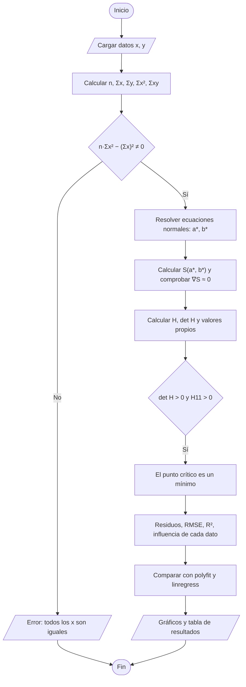

# Pseudocódigo y diagrama de flujo

Corresponde a `codigo/regresion.py` (método propio). La rúbrica pide "pseudocódigo o diagrama de flujo" y "relación código–modelo".

## Pseudocódigo

```
INICIO
  leer el archivo de datos → listas x, y
  n ← cantidad de datos
  Sx ← 0; Sy ← 0; Sxx ← 0; Sxy ← 0
  PARA cada par (xi, yi):
      Sx ← Sx + xi;        Sy ← Sy + yi
      Sxx ← Sxx + xi·xi;   Sxy ← Sxy + xi·yi
  det ← n·Sxx − Sx·Sx
  SI det = 0: informar "todos los x son iguales" y terminar
  a ← (n·Sxy − Sx·Sy) / det
  b ← (Sxx·Sy − Sx·Sxy) / det
  Smin ← suma de (yi − a·xi − b)² para todos los datos
  H ← [[2·Sxx, 2·Sx], [2·Sx, 2·n]]
  D ← H11·H22 − H12²
  SI D > 0 y H11 > 0: informar "el punto crítico es un mínimo"
  calcular residuos, RMSE y R²
  comparar a, b, Smin con la función de la librería
  generar los gráficos
FIN
```

## Diagrama de flujo



## Relación código–modelo

| Matemática | Función |
|---|---|
| $\sum x_i,\ \sum y_i,\ \sum x_i^2,\ \sum x_i y_i$ | `sumas(x, y)` |
| Solución de $\nabla S = 0$ | `ajustar(x, y)` |
| $S(a,b)$ | `error_cuadratico(a, b, x, y)` |
| $\nabla S$ | `gradiente(a, b, x, y)` |
| $H$, $\det H$, valores propios | `hessiano(x)`, `analizar_hessiano(H)` |
| $e_i$, RMSE, $R^2$ | `residuos`, `rmse`, `r_cuadrado` |
